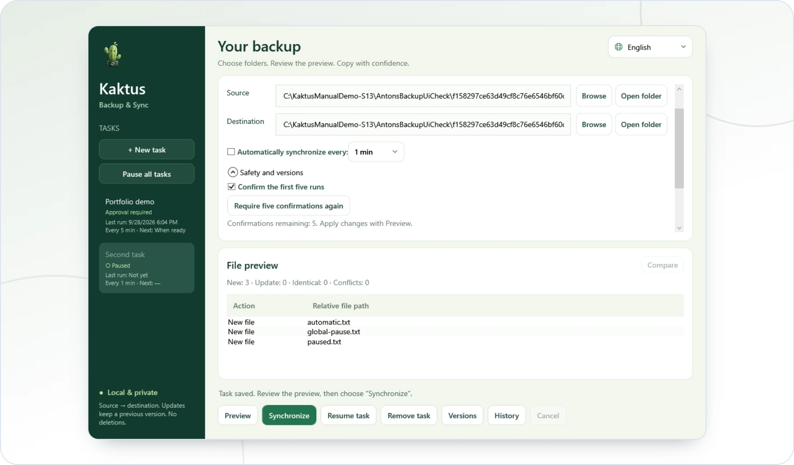

<!-- ppk-readme:head:start -->
<a href="https://popovantondev.github.io/Kaktus-Backup-Sync/index-en.html"><picture><source media="(prefers-color-scheme: dark)" srcset="https://raw.githubusercontent.com/popovantondev/Kaktus-Backup-Sync/main/docs/readme/header-en-dark.3d7ef3a9.svg"></picture></a>
<!-- ppk-readme:head:end -->

# Kaktus Backup & Sync

[Русский](README.ru.md) · [Deutsch](README.md) · **English**

<!-- ppk-readme:body:start -->
<p>
<a href="https://github.com/popovantondev/Kaktus-Backup-Sync/releases/tag/v5.2.0-preview.7"><picture><source media="(prefers-color-scheme: dark)" srcset="https://raw.githubusercontent.com/popovantondev/Kaktus-Backup-Sync/main/docs/readme/btn-download-en-dark.482bdb12.svg"></picture></a>
<a href="https://popovantondev.github.io/Kaktus-Backup-Sync/index-en.html"><picture><source media="(prefers-color-scheme: dark)" srcset="https://raw.githubusercontent.com/popovantondev/Kaktus-Backup-Sync/main/docs/readme/btn-website-en-dark.20d59532.svg"></picture></a>
<a href="https://popovantondev.github.io/Kaktus-Backup-Sync/Guide-en.html"><picture><source media="(prefers-color-scheme: dark)" srcset="https://raw.githubusercontent.com/popovantondev/Kaktus-Backup-Sync/main/docs/readme/btn-guide-en-dark.b13ac50b.svg"></picture></a>
<a href="https://popovantondev.github.io/Kaktus-Backup-Sync/index-en.html#demo"><picture><source media="(prefers-color-scheme: dark)" srcset="https://raw.githubusercontent.com/popovantondev/Kaktus-Backup-Sync/main/docs/readme/btn-demo-en-dark.87168c70.svg"></picture></a>
<a href="https://github.com/popovantondev/Kaktus-Backup-Sync/issues/new/choose"><picture><source media="(prefers-color-scheme: dark)" srcset="https://raw.githubusercontent.com/popovantondev/Kaktus-Backup-Sync/main/docs/readme/btn-bug-en-dark.90c65845.svg"></picture></a>
</p>

<p><a href="https://raw.githubusercontent.com/popovantondev/Kaktus-Backup-Sync/main/docs/images/manual/en-main.png"><picture><source media="(prefers-color-scheme: dark)" srcset="https://raw.githubusercontent.com/popovantondev/Kaktus-Backup-Sync/main/docs/readme/preview-en-dark.61c5e08e.webp"></picture></a><br>
<sub><a href="https://raw.githubusercontent.com/popovantondev/Kaktus-Backup-Sync/main/docs/images/manual/en-main.png">Full screenshot</a></sub></p>

<picture><source media="(prefers-color-scheme: dark)" srcset="https://raw.githubusercontent.com/popovantondev/Kaktus-Backup-Sync/main/docs/readme/divider-dark.bab18a3d.svg"></picture>
<!-- ppk-readme:body:end -->

<!-- public-release:start -->
One-way folder backup with a preview and preserved previous file versions.

**Windows · x64 · Preview 5.2.0-preview.7**

**[Download](https://github.com/popovantondev/Kaktus-Backup-Sync/releases/tag/v5.2.0-preview.7)** · **[User guide](https://popovantondev.github.io/Kaktus-Backup-Sync/Guide-en.html)** · **[Report a problem](https://github.com/popovantondev/Kaktus-Backup-Sync/issues/new/choose)**

**Requirements and limitations:** Portable package includes .NET; Python and an SDK are not needed. This is a preview release.

**First steps:** Extract the entire ZIP and open KaktusBackupSync.exe. Choose source and target, then review the plan before syncing.

**Application files:**

- [`Kaktus-Backup-Sync-Portable-5.2-preview.7.zip`](https://github.com/popovantondev/Kaktus-Backup-Sync/releases/download/v5.2.0-preview.7/Kaktus-Backup-Sync-Portable-5.2-preview.7.zip)

**Checksums:** [`Kaktus-Backup-Sync-Portable-5.2-preview.7.zip.sha256`](https://github.com/popovantondev/Kaktus-Backup-Sync/releases/download/v5.2.0-preview.7/Kaktus-Backup-Sync-Portable-5.2-preview.7.zip.sha256) · [`Kaktus-Backup-Sync-Source-5.2-preview.7.zip.sha256`](https://github.com/popovantondev/Kaktus-Backup-Sync/releases/download/v5.2.0-preview.7/Kaktus-Backup-Sync-Source-5.2-preview.7.zip.sha256)
<!-- public-release:end -->

A Windows preview for one-way backup with preview, previous versions, automatic tasks and a tray interface. German is the default; English and Russian are available.

## First steps

Extract the portable ZIP and run `KaktusBackupSync.exe`. The required .NET runtime is included; no Python, SDK or installer is needed. Settings live in `runtime` beside the EXE. [Portable quick start](docs/START-HERE.txt).

Compare the downloaded ZIP's SHA-256 with the value listed for that release. Extract the complete ZIP folder; the application does not need a separate installation.

1. Create a task with existing source and destination folders.
2. **Preview** saves it and displays the plan.
3. **Synchronize** runs the confirmed plan.
4. Optionally enable checks every 1, 5, 15, 30 or 60 minutes.

New tasks require five successful manual confirmations. Change or reset this under **Safety and versions**. Pause one task or all tasks. Closing hides the window; exit from the tray menu. Updates keep previous destination versions, seven by default. Working destination files are not automatically deleted.

## Documentation

- [English user manual](docs/MANUAL.en.md): installation, portable use, updates, recovery, architecture, build commands and limits
- [Deutsches Benutzerhandbuch](docs/HANDBUCH.de.md)
- [Русское руководство](docs/MANUAL.ru.md)
- [Portable quick start](docs/START-HERE.txt)
- [Changelog](CHANGELOG.md) · [Release notes](docs/release-notes.en.md)
- [Architecture](docs/ARCHITECTURE.md) · [Source package](docs/SOURCE-PACKAGE.md)

## Privacy

Selected folders are processed locally; the application does not upload files. Tasks and history are stored in the local `runtime` folder. Screenshots and bug reports may show personal paths or file names; remove them before sharing.

## Rights

The source is public for viewing but is not open source. Individuals may download and run an unmodified release binary for personal use. See [rights and permitted use](RIGHTS.md), [third-party notices](THIRD_PARTY_NOTICES.md), and the [license text](LICENSE). Feedback is welcome in English, German, or Russian.

## Build and verify

Windows and .NET SDK 10.0.400:

```powershell
dotnet test --project tests/AntonsBackupManager.Core.Tests -c Release
dotnet build tests/AntonsBackupManager.UiCheck -c Release -o runtime/ui-check
dotnet runtime/ui-check/AntonsBackupManager.UiCheck.dll runtime/ui-audit
dotnet runtime/ui-check/AntonsBackupManager.UiCheck.dll --crash-check
./tools/Publish.ps1
./tools/Test-Package.ps1
```

The portable ZIP already contains `portable.flag`. Move the whole program folder together with `runtime`. Tests do not replace clean-machine and physical failure testing. Source available for viewing; [all rights reserved](LICENSE).
