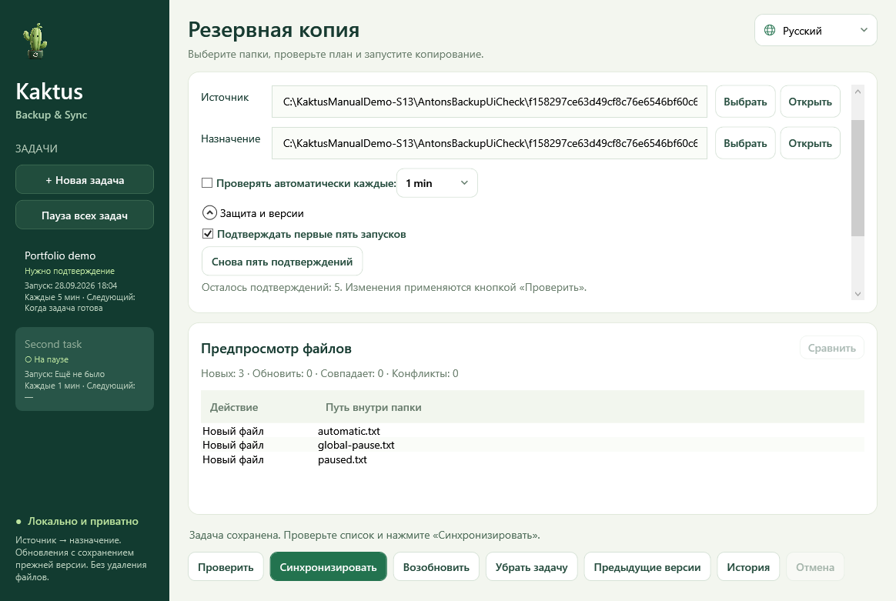

<div align="center">
  
</div>

# Kaktus Backup & Sync

**Русский** · [Deutsch](README.md) · [English](README.en.md)

<!-- public-release:start -->
Выполняет одностороннее резервное копирование папок с предварительным просмотром и сохранением предыдущих версий.

**Windows · x64 · Предварительный выпуск 5.2.0-preview.7**

**[Скачать](https://github.com/popovantondev/Kaktus-Backup-Sync/releases/tag/v5.2.0-preview.7)** · **[Инструкция](https://popovantondev.github.io/Kaktus-Backup-Sync/Guide-ru.html)** · **[Сообщить об ошибке](https://github.com/popovantondev/Kaktus-Backup-Sync/issues/new/choose)**

**Требования и ограничения:** Portable-пакет содержит .NET. Установка Python и SDK не нужна. Это предварительный выпуск.

**Первые шаги:** Распакуйте ZIP целиком и откройте KaktusBackupSync.exe. Выберите источник и цель, проверьте план перед синхронизацией.

**Файлы приложения:**

- [`Kaktus-Backup-Sync-Portable-5.2-preview.7.zip`](https://github.com/popovantondev/Kaktus-Backup-Sync/releases/download/v5.2.0-preview.7/Kaktus-Backup-Sync-Portable-5.2-preview.7.zip)

**Контрольные суммы:** [`Kaktus-Backup-Sync-Portable-5.2-preview.7.zip.sha256`](https://github.com/popovantondev/Kaktus-Backup-Sync/releases/download/v5.2.0-preview.7/Kaktus-Backup-Sync-Portable-5.2-preview.7.zip.sha256) · [`Kaktus-Backup-Sync-Source-5.2-preview.7.zip.sha256`](https://github.com/popovantondev/Kaktus-Backup-Sync/releases/download/v5.2.0-preview.7/Kaktus-Backup-Sync-Source-5.2-preview.7.zip.sha256)
<!-- public-release:end -->

**[Сайт](https://popovantondev.github.io/Kaktus-Backup-Sync/index-ru.html)** · **[Попробовать в браузере](https://popovantondev.github.io/Kaktus-Backup-Sync/index-ru.html#demo)**



Предварительная Windows-программа для односторонней синхронизации: просмотр плана, предыдущие версии, автоматические задачи и трей. Немецкий язык основной; русский и английский переключаются без перезапуска.

## Первые шаги

Распакуйте переносной ZIP и запустите `KaktusBackupSync.exe`. Нужная среда .NET уже внутри; Python, SDK и установка не нужны. Настройки — в папке `runtime` рядом с EXE. [Краткая инструкция по переносу](docs/START-HERE.txt).

Сверьте SHA-256 скачанного ZIP со значением на странице релиза. Распакуйте архив целиком: отдельная установка программе не нужна.

1. Создайте задачу и укажите существующие источник и назначение.
2. **Проверить** сохраняет задачу и показывает план.
3. **Синхронизировать** выполняет подтверждённый план.
4. По желанию включите проверки каждые 1, 5, 15, 30 или 60 минут.

Первые пять успешных запусков требуют ручного подтверждения. Защита меняется в **Защите и версиях**. Есть отдельная и общая пауза. Крестик скрывает окно; завершение — через меню трея. Перед обновлением сохраняется прежняя версия назначения, по умолчанию семь версий. Рабочие файлы автоматически не удаляются.

## Документация

- [Русское руководство](docs/MANUAL.ru.md): установка, перенос, восстановление, устройство кода и проверки
- [Deutsches Benutzerhandbuch](docs/HANDBUCH.de.md)
- [English user manual](docs/MANUAL.en.md)
- [Краткая инструкция по переносу](docs/START-HERE.txt)
- [История изменений](CHANGELOG.md) · [Заметки к выпуску](docs/release-notes.ru.md)
- [Архитектура](docs/ARCHITECTURE.md) · [Исходники](docs/SOURCE-PACKAGE.md)

## Конфиденциальность

Выбранные папки обрабатываются локально, приложение не загружает файлы в сеть. Задачи и история сохраняются в локальной папке `runtime`. На скриншотах и в сообщениях об ошибках могут быть личные пути или имена файлов — удалите их перед отправкой.

## Права

Исходники открыты для просмотра, но это не open source. Частные лица могут скачивать и запускать неизменённую программу из релиза для личного использования. Подробнее: [права и условия](RIGHTS.md), [сторонние компоненты](THIRD_PARTY_NOTICES.md), [текст лицензии](LICENSE). Отзывы можно писать на русском, немецком или английском.

## Сборка и проверка

Windows и .NET SDK 10.0.400:

```powershell
dotnet test --project tests/AntonsBackupManager.Core.Tests -c Release
dotnet build tests/AntonsBackupManager.UiCheck -c Release -o runtime/ui-check
dotnet runtime/ui-check/AntonsBackupManager.UiCheck.dll runtime/ui-audit
dotnet runtime/ui-check/AntonsBackupManager.UiCheck.dll --crash-check
./tools/Publish.ps1
./tools/Test-Package.ps1
```

В переносном ZIP уже лежит `portable.flag`. Переносите всю папку программы вместе с `runtime`. Перенос прежних задач и версий описан в руководстве. Тесты не заменяют испытания на чистом компьютере и при аппаратных сбоях. Исходники для просмотра; [все права сохранены](LICENSE).
